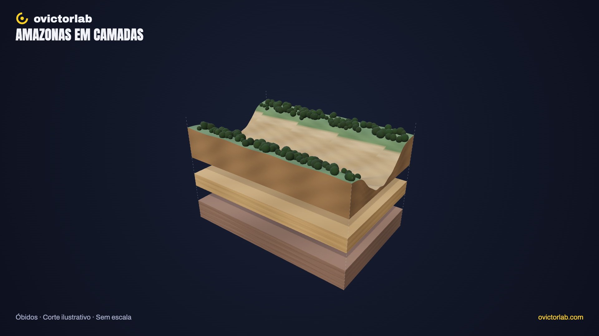

# Amazonas em camadas

**[Abrir a experiência →](https://victorsodre.github.io/amazonas-em-camadas/)** · [Os 10 experimentos](docs/COLECAO.md) · [Publicação e manutenção](docs/PUBLICACAO.md)

[](https://victorsodre.github.io/amazonas-em-camadas/)

**O que existe abaixo da superfície do Amazonas?**

Um corte geográfico localizado, com água, leito e camadas do subsolo identificadas. Usar um esquema claramente ilustrativo enquanto não houver batimetria verificável.

Direção e autoria editorial: **Victor Sodré / ovictorlab**. [Site](https://ovictorlab.com/) · [Referência Fusquinha](https://victorsodre.github.io/fusquinha/) · [Repositório](https://github.com/victorsodre/amazonas-em-camadas).

## Por que desenvolver

O Reel registrou 540.517 visualizações, 1.539 salvamentos e 2.498 compartilhamentos no Instagram. Alcance elevado não elimina a necessidade de verificar a representação científica. Consulta em 07/11/2026. Métricas acumuladas são sinais de interesse; não comprovam demanda pelo aplicativo ou alcance orgânico.

- [Amazonas — Instagram](https://www.instagram.com/reel/DeNhjYVKQOm/)
- [Amazonas — YouTube](https://www.youtube.com/watch?v=UBBU6FyUwRM)

## Começar por aqui

1. [Escopo e critérios de conclusão](docs/ESCOPO.md).
2. [Lista de execução](docs/EXECUCAO.md).
3. [Identidade visual do ovictorlab](docs/IDENTIDADE-VISUAL.md).
4. [Arquitetura e reaproveitamento do Fusquinha](docs/ARQUITETURA.md).
5. [Assets e fontes apuradas](docs/ASSETS-E-FONTES.md).
6. [Manutenção, validação e publicação](docs/MANUTENCAO.md).
7. [Decisões e estado do projeto](docs/DECISOES.md).
8. [Textos para o X](POSTAGENS-X.md) e [ordem da coleção](docs/COLECAO.md).

## Experiência entregue

Óbidos, Pará, é a referência documentada. A cena é um corte autoral **sem escala**, com quatro conjuntos: água, leito/margens, depósitos e subsolo sedimentar. Retire a água da vista, separe as camadas, selecione, isole e reenquadre. Uma vista própria mostra água entre grãos, sem representar um canal subterrâneo.

As fichas explicam origem, data, método, resolução e limites de cada informação. Busca, tour de quatro etapas, malha, tela cheia e PNG 16:9/9:16 completam a exploração. Marca e tipografia oficiais, fontes locais e nenhum mapa, foto, som ou modelo de terceiros incorporado.

## Executar

Node.js >=22.18; versões exatas no lockfile.

```sh
npm ci
npm run dev
npm test
npm run check
npm run build
npm run preview
```

`dev`: http://127.0.0.1:4311/ . `preview` informa a porta. Build estático em `dist/`, com base relativa e subpasta conferida. Sem backend, LLM, credenciais ou uso da GPU de produção.

## Evidências e limites

[APURACAO.md](docs/APURACAO.md) documenta o estudo local, a referência geográfica e a pesquisa relacionada ao Hamza. [VALIDACAO.md](docs/VALIDACAO.md) registra sete testes, 94 verificações de navegador e a inspeção visual. Validação móvel por viewport no Chrome do Mac, sem telefone físico.

Não há batimetria medida, previsão hidrológica ou coluna estratigráfica reconstruída. Retirar água altera visibilidade; separar camadas cria intervalos de exploração. A amostra de poros é conceitual. Esses limites aparecem na interface e nos PNGs.

Guias de manutenção/identidade em `docs/`. [POSTAGENS-X.md](POSTAGENS-X.md) contém rascunhos para Victor; publicação é posterior.
